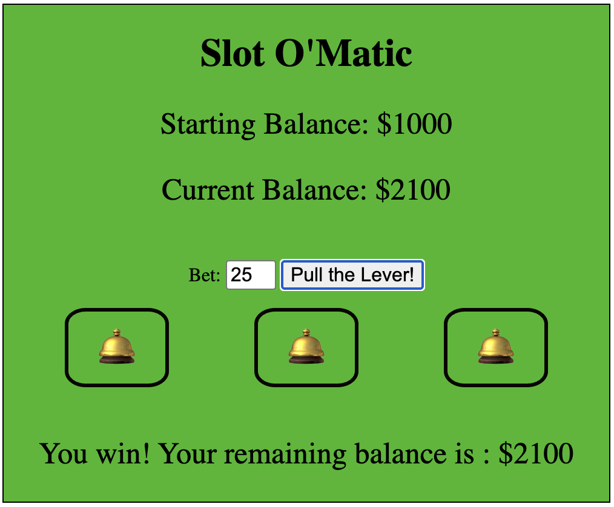

# Slot O'Matic

A simple slot machine: place a bet, pull the lever, and see if all three reels match.

A small front-end exercise where everything runs in the browser — the balance is not saved anywhere, so reloading the page restarts with $1000.



## What it does

- Starts with a $1000 balance. Place a bet between $5 and $50 and click **Pull the Lever!**
- Spins three reels, each landing on one of five symbols: bell, cherry, 7, money bag, or crown.
- Three matching symbols wins and the balance goes up; anything else loses the bet, and the balance goes down.
- Bets outside $5–$50, or more than your balance, are rejected with a message.
- If the balance hits $0, the game tells you you're out of money — reload the page to play again.

## Tech stack

- HTML, CSS, JavaScript (no build step, no server, no storage)

## How to run it

Open `index.html` in a browser and place a bet.

## Project structure

```
index.html              - balance, bet input, lever button, and the three reels
css/style.css           - page styling
css/normalize.css
css/reset.css
js/main.js              - bet checks, reel spins, win/lose, and balance updates
README-slotmachine.md   - the original rules notes for the game
```

---

Thay Brown — thaybrown22@gmail.com · https://thaythecoder.netlify.app · https://github.com/tbrown320 · https://www.linkedin.com/in/thaybrown
